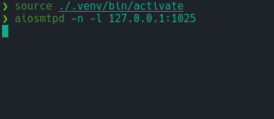
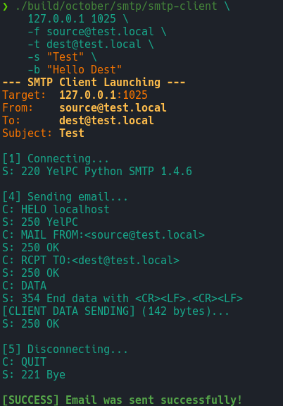
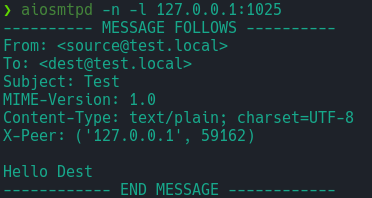
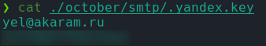
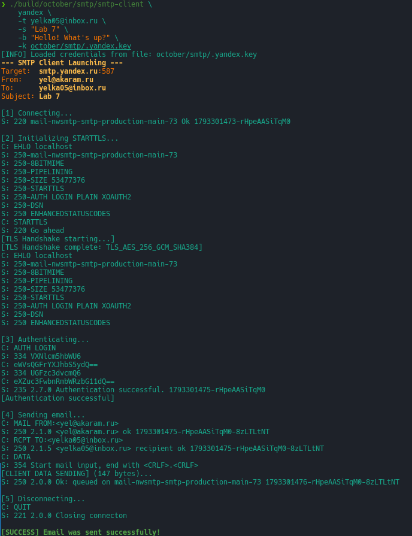
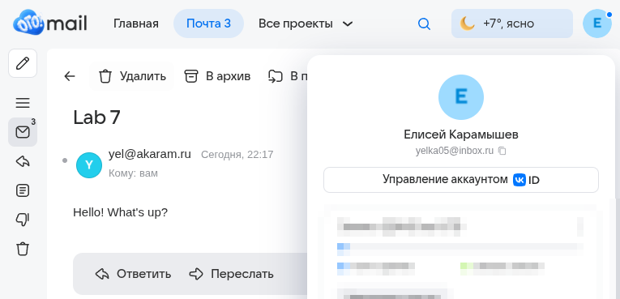

# Демонстрация

| [↑](..) | [⟵ Сборка](./BUILD.md) |
|---------|------------------------|

## Локально

### 1. Запуск сервера

### 2. Отправка запроса

### 3. Логи сервера

## Глобально

### 1. Файл с ключём

### 2. Отправка запроса

### 3. Получение письма

| [⟵ Сборка](./BUILD.md) |
|------------------------|
