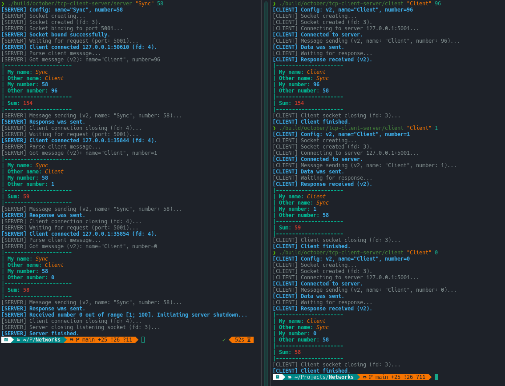
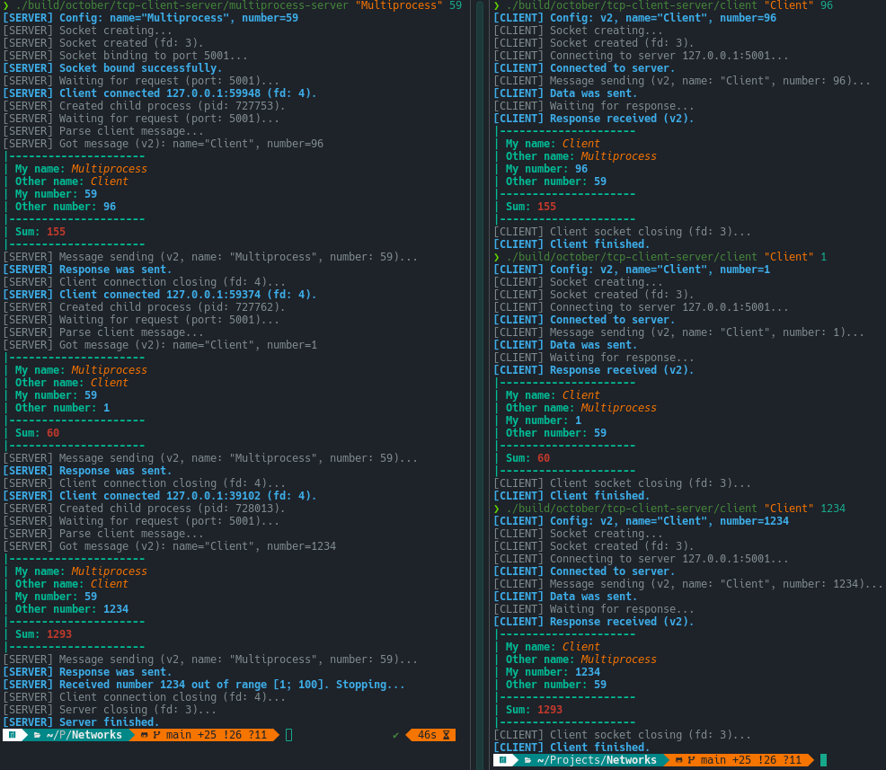
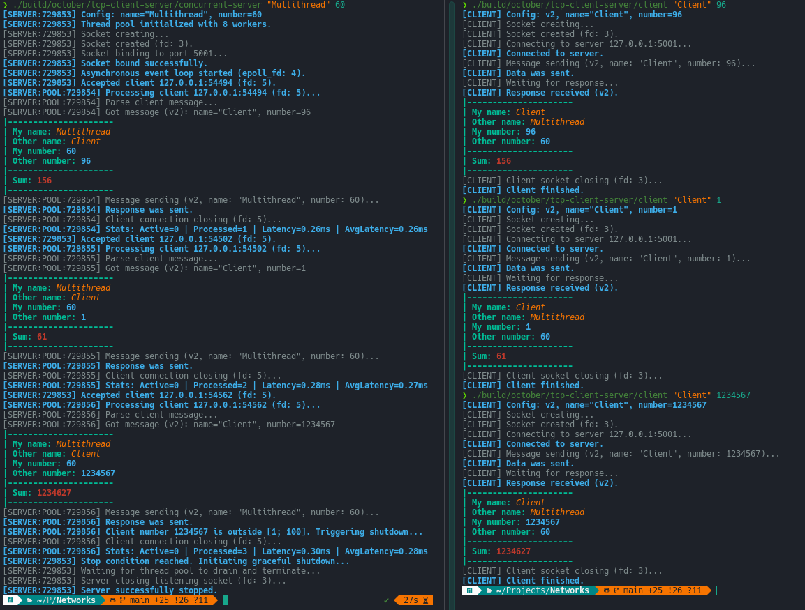
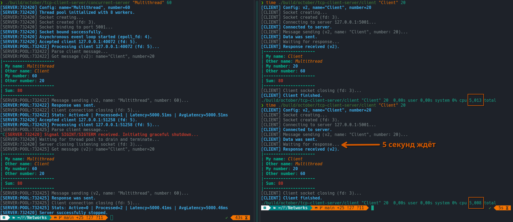
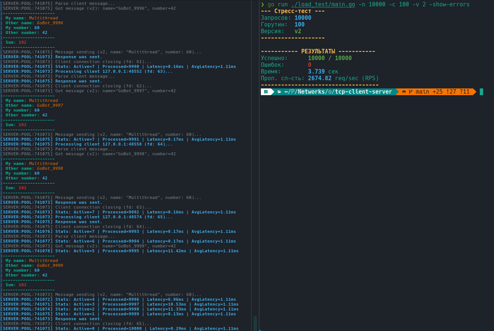
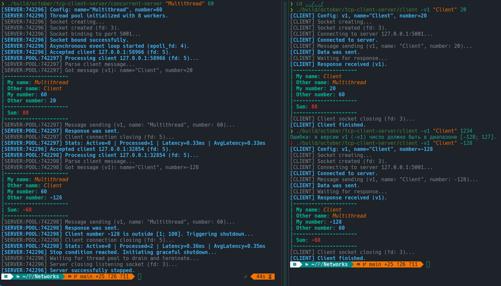
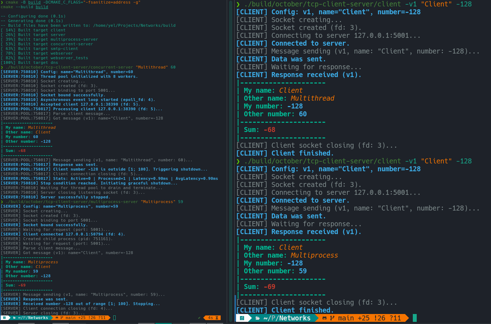

# Демонстрация

| [⟵ Сборка](./BUILD.md) |
|------------------------|

## 1. Жизненный цикл
### 1.1. Синхронный сервер (sync)

**_Запуск сервера, обмен данными с клиентом и остановка числом вне диапазона [1; 100]_**

### 1.2. Многопроцессный сервер (multiprocess)

**_Запуск сервера, конкурентная обработка клиентов через fork() и остановка_**

### 1.3. Многопоточный сервер (multithreading)

**_Запуск epoll с пулом потоков, обработка запросов и остановка_**

### 2. Graceful Shutdown по сигналу SIGINT (Ctrl+C)

Специально на стороне сервера была установлена задержка в 5с.

Сервер не разрывает соединение моментально, а обрабатывает его до конца.

### 3. Нагрузочное тестирование на Go (1000 запросов) и статистика задержек

### 3. Протокол v1

### 4. Проверка утечек памяти

**_Компиляция с санитайзером._**

**Чистый вывод ⟶ утечек нет.**

| [⟵ Сборка](./BUILD.md) |
|------------------------|