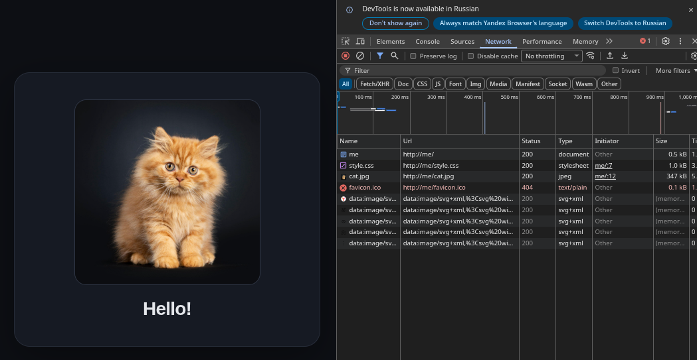
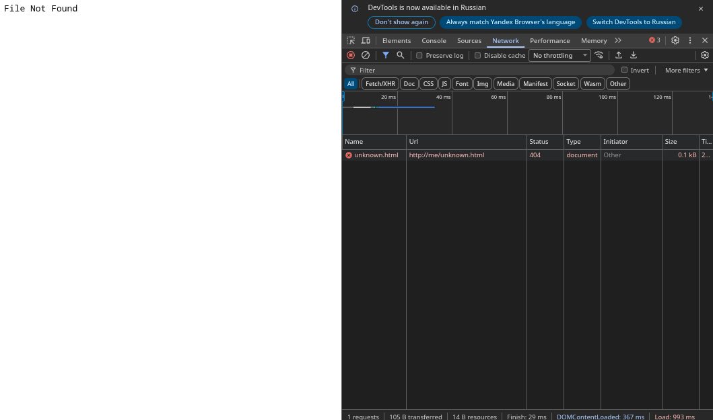

# Демонстрация

| [⟵ Сборка](./BUILD.md) |
|------------------------|

## 1. Загрузка HTML, CSS и PNG в браузере

Отображение страницы `index.html` со стилями `style.css` при обращении к серверу:



### Логи сервера
```
[server] listening on 0.0.0.0:80 root=/home/yel/Projects/Networks/october/webserver/public
[conn 4] accepted
[conn 4] GET / HTTP/1.1
[conn 4] 200 OK
[conn 4] connection closed
[conn 4] accepted
[conn 4] GET /style.css HTTP/1.1
[conn 4] 200 OK
[conn 4] connection closed
[conn 4] accepted
[conn 4] GET /cat.jpg HTTP/1.1
[conn 4] 200 OK
[conn 4] connection closed
[conn 4] accepted
[conn 4] GET /favicon.ico HTTP/1.1
[conn 4] 404 Not Found
[conn 4] connection closed
```

Тут уже видно, что браузер попытался запросить иконку сайта, но получил 404.

## 2. Обработка ошибок

### 2.1. Ресурс не найден (404 Not Found)

Запрос к несуществующему файлу в браузере:



### 2.2. Защита от выхода за пределы директории

Попытка запроса файла вне папки `public/` (например, `/../../etc/passwd`):
#### Клиент
```bash
> curl -i http://me/../../../../../../../etc/passwd
HTTP/1.1 404 Not Found
Content-Type: text/plain
Content-Length: 14
Connection: close

File Not Found
```

#### Логи сервера
```bash
[conn 4] GET /etc/passwd HTTP/1.1
[conn 4] 404 Not Found
[conn 4] connection closed
```

Но при этом:
```bash
❯ ls ../../../../../../../etc/passwd
../../../../../../../etc/passwd
```
Файл существует.

## 4. Graceful Shutdown по сигналу SIGINT (Ctrl+C)
### Подготовка
Создаём большой файл, который даст время на остановку сервера

```bash
head -c 20M /dev/urandom > ./public/big.bin
```

### Клиент
Запускаем
```bash
curl -i --limit-rate 500K http://127.0.0.1/big.bin -o /dev/null
```

Тут стоит ограничение на скорость передачи, что позволяет достичь "потолка" буфера ядра и замедлить передачу данных самим сервером.

После этого посылаем SIGINT

### Логи сервера

```bash
[server] listening on 0.0.0.0:80 root=/home/yel/Projects/Networks/october/webserver/public
[conn 4] accepted
[conn 4] GET /big.bin HTTP/1.1
[conn 4] 200 OK
^C[server] shutdown requested # Получен сигнал
[conn 4] connection closed  # И только после передачи данных закрывает соединение
[server] stopped # И завершает работу
```

### Логи клиента

```
% Total    % Received % Xferd  Average Speed  Time    Time    Time   Current
                               Dload  Upload  Total   Spent   Left   Speed
100 20.00M 100 20.00M   0      0 500.2k      0   00:40   00:40         499.9k
```

Мы видим, что клиент, несмотря на остановку сервера, получил весь файл.

| [⟵ Сборка](./BUILD.md) |
|------------------------|
